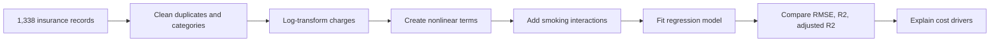

# Health Insurance Cost Prediction

### Explain which factors drive medical costs with interpretable Python regression

[](https://www.python.org/)
[](https://scikit-learn.org/)
[](https://en.wikipedia.org/wiki/Regression_analysis)

This project models medical insurance charges for 1,338 policyholders and explains how age, BMI, smoking status, and their interactions relate to predicted cost. The workflow is designed for an analyst who needs a model that is interpretable enough to discuss with business or policy stakeholders.

## Contents

- [Business question](#business-question)
- [Key result](#key-result)
- [Quick start](#quick-start)
- [Modeling workflow](#modeling-workflow)
- [Example interpretation](#example-interpretation)
- [Project structure](#project-structure)
- [Limitations and known issues](#limitations-and-known-issues)
- [Contribution](#contribution)
- [Support](#support)
- [License](#license)

## Business question

How can an insurance-cost model capture skewed charges and nonlinear risk relationships without becoming impossible to explain? This project compares a baseline regression with log-transformed, nonlinear, and interaction-based specifications.

## Key result

The extended model improved adjusted R² from approximately **0.782 to 0.838** by adding log transformation, quadratic terms, and interactions. In validation, the Python workflow achieved an R² of approximately **0.836**.

The strongest business signal is smoking status. For the example profile used in the analysis, predicted charges increase from about **$2,757** to **$22,148** when smoking status changes, illustrating why interaction effects matter.

## Quick start

### Prerequisites

- Python 3.10 or newer
- Git

```powershell
git clone https://github.com/rlaaudwp96/Health-Insurance-Cost-Analysis-Price-Prediction.git
cd Health-Insurance-Cost-Analysis-Price-Prediction
python -m venv .venv
.\.venv\Scripts\Activate.ps1
pip install -r requirements.txt
python health_insurance_analysis.py
```

The script prints model metrics and an example prediction using the included dataset.

## Modeling workflow



The Python implementation uses pandas, NumPy, and scikit-learn for cleaning, feature engineering, one-hot encoding, regression, and evaluation.

## Example interpretation

Smoking status is not treated as an isolated checkbox. The model also examines how smoking interacts with age, BMI, and sex, allowing the cost curve to change across different customer profiles.

## Project structure

```text
Health-Insurance-Cost-Analysis-Price-Prediction/
├── health_insurance_analysis.py  # Reproducible Python workflow
├── insurance.csv                  # Insurance dataset
├── requirements.txt               # NumPy, pandas, scikit-learn
└── README.md
```

## Limitations and known issues

- The dataset is a benchmark dataset, not a production insurance portfolio.
- Association in the data should not be interpreted as causal evidence.
- Predictions are sensitive to the feature distribution and should be validated on current data before use.
- The example dollar values are model outputs, not pricing recommendations.

## Contribution

Open an issue with a reproducible example, keep feature engineering and model changes in `health_insurance_analysis.py`, and report metric changes with the same evaluation setup.

## Support

Use GitHub Issues or connect with [Myungje Kim on LinkedIn](https://www.linkedin.com/in/evan-kim-257857249/).

## License

No open-source license has been specified yet. Contact the repository owner before redistributing or adapting the code.
